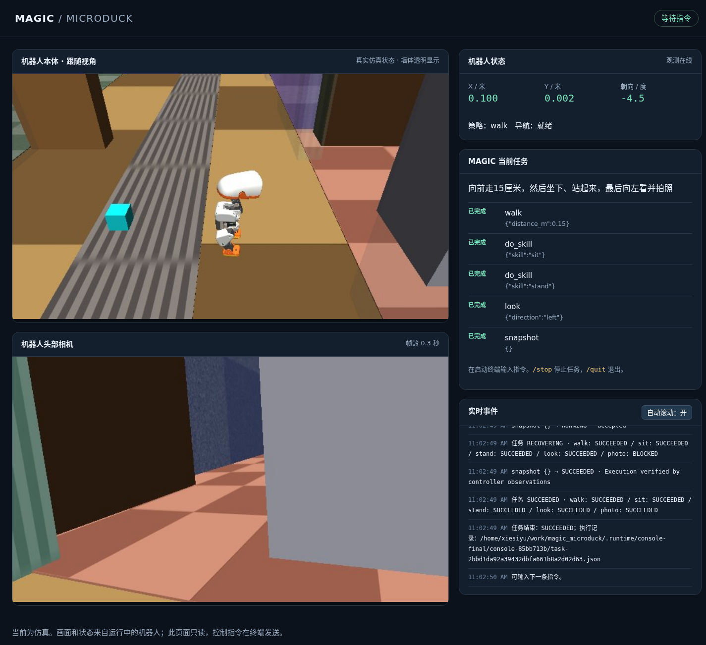

# Microduck Simulation Integration

Geek Mind's MAGIC task runtime now connects to **[Microduck in MuJoCo / ROS 2](https://github.com/Arjunros/microduck_ros2)**. An interactive terminal accepts natural-language goals, executes the resulting plan, and displays agent status and action receipts. A browser shows the simulated robot's body, its head camera, and the current task.

> Project-reported validation: 2026-11-09. This integration has been exercised in simulation; no physical Microduck was connected.



*A recorded operator view after a five-action demo completed. The running application streams both views; the public project page shows this static capture.*

## Architecture

```text
Natural-language instruction + current robot state
    → MAGIC TaskPlanner / configured LLM
    → TaskRuntime → ExecutionGateway → MCPClientManager
    → MCP stdio tools → local HTTP / ROS 2 bridge
    → MuJoCo robot + learned motion policies + Nav2
    → robot state, action receipts, task results

Simulation scene + live joint state
    → MuJoCo observer → head camera + third-person follow view
    → read-only browser panel

Task plan + execution events
    → interactive terminal + browser panel + local session records
```

The integration reuses MAGIC's planner and execution kernel. It lives in a separate `magic_microduck` workspace alongside `MAGIC` and `microduck_ros2`, without modifying their source for the adapter. MAGIC runs in Python 3.11; ROS 2 and MuJoCo run in the Microduck project's Python 3.12 / Pixi environment. Local HTTP separates the two Python environments, while MCP presents typed tools to the task runtime.

The observer reads the actual simulation scene, object configuration, and joint state. Walls become transparent only in the third-person renderer so the body stays visible; physical collisions and the head camera retain the original scene.

## Start an interactive session

These commands apply to the **prepared integration workspace** used for validation:

```text
work/
├── MAGIC/               # Existing MAGIC environment and model configuration
├── microduck_ros2/      # Existing ROS 2 / Pixi simulation environment
└── magic_microduck/     # Integration, launcher, terminal, and viewer
```

The adapter currently resides in this separate workspace. Cloning the Geek-Mind website repository alone does not install it or prepare the simulator. The integration's own `README.md`, `.env.example`, and `run.sh` describe its environment and configuration.

From `work/`:

```bash
cd magic_microduck
bash run.sh chat
```

The launcher starts the apartment simulation, navigation, bridge, observer, and MAGIC console. Once ready, enter a goal in the terminal:

```text
向左转20度，然后坐下，再站起来
```

This command—“Turn left 20 degrees, sit down, then stand up”—was successfully planned by the configured model and executed in the simulator. The terminal shows the current goal, planned actions, robot state, action statuses, and results. After completion, enter another goal in the same session.

Open **http://127.0.0.1:8780** for the operator view. It contains a third-person follow camera, the head camera, pose and policy state, task progress, and the event stream. Commands are entered in the terminal; the browser is read-only.

For a remote server, forward the viewer port from your own computer:

```bash
ssh -N -L 8780:127.0.0.1:8780 user@server
```

Then open the same local browser address. The server does not require a desktop session.

| Terminal input | Behavior |
| --- | --- |
| Natural-language goal | Plan and execute using the configured model; accept the next goal after completion |
| `/demo` | Run the fixed five-action plan through MAGIC without a model call |
| `/state` | Show current robot and task state |
| `/stop` | Request cancellation and prevent remaining actions from starting |
| `/reset` | Reset the simulation when no task is running |
| `/help` | Show console commands |
| `/quit`, Ctrl+C, Ctrl+D | End the session and close the processes it started |

Use `bash run.sh chat --plain` for line-oriented input and logs, `--flat` for the flat scene, or `--no-browser` to suppress automatic browser opening. A session that attaches to an already running bridge leaves that external simulation running on exit.

## Model and motion configuration

By default, the adapter reuses MAGIC's existing `BENCHMARK_BASE_URL`, `BENCHMARK_MODEL`, and `BENCHMARK_API_KEY` configuration. Adapter-specific overrides are `MAGIC_LLM_BASE_URL`, `MAGIC_LLM_MODEL`, and `MAGIC_LLM_API_KEY`. Store private values in the integration's `.env` or the process environment; the model must support the OpenAI-compatible tool-calling interface.

An optional `--vision` mode attaches the head-camera image to planning and requires an image-capable model. The default text-planning workflow does not imply visual object recognition.

The integration pins the official v8 walking policy to revision `665ae4eb20bfe13bca1ef4ea6d4bb6b4a096e448`, checks its SHA256, and keeps it in the integration's `.assets/` directory. This supplies the turning behavior required by the navigation configuration. Other learned policies reuse the existing Microduck assets. See the [upstream policy manifest](https://huggingface.co/pollen-robotics/microduck-policies/blob/665ae4eb20bfe13bca1ef4ea6d4bb6b4a096e448/manifest.json) for the versioned policy source.

## Tools and execution

Seven MCP tools connect the task runtime to the bridge:

| Tool | Purpose |
| --- | --- |
| `get_state` | Read robot state, navigation readiness, and named places |
| `get_capabilities` | Discover supported actions and their bounds |
| `submit_action` | Start a bounded action and return its command ID |
| `get_action_status` | Retrieve progress and the terminal action result |
| `cancel_action` | Request cancellation of a specific action |
| `stop` | Request a stop through the bridge |
| `get_image` | Return the head-camera image |

Actions cover `walk`, `turn`, `navigate`, `navigate_to`, `do_skill`, `look`, and `snapshot`. The runtime serializes robot control, validates parameters, and persists action receipts. Reusing a command ID with the same parameters returns the existing receipt instead of executing it again. Failure or cancellation prevents dependent actions from starting.

Sessions save plans, task results, and event records under `magic_microduck/.runtime/console-*/`. Continuous video uses an in-memory frame cache and MJPEG streams; it does not save a screenshot on every update.

## Verified behavior

The [public validation summary](./docs/assets/microduck-validation.json) records the observed results and their local provenance. It contains no API credentials, private logs, or runtime databases.

| Check | Observed result |
| --- | --- |
| Automated integration checks | **23 passed**, including cancellation, action ordering, Chinese input/history, stale video, and event persistence |
| Real-model command | Turn left 20°, sit, and stand all completed; a separate sit/stand command also completed |
| Fixed `/demo` sequence | Walk 15 cm → sit → stand → look left → snapshot; all five nodes `SUCCEEDED` |
| Cancel during walking | A two-meter walk ended `CANCELLED`; the following sit action was never dispatched |
| Cancel during planning | No robot action was dispatched |
| Browser observation | Both 640 × 360 views loaded; no JavaScript exceptions in the validation session |
| Frame freshness | 15 distinct frames per view over approximately 5 seconds; maximum sampled frame age 0.569 s / 0.454 s |
| Continuous viewing | Zero new screenshot files during the viewing check |
| Navigation, 2026-11-08 | North-corridor arrival error approximately 0.229 m within a 0.3 m tolerance; kitchen-route cancellation also verified |

These are checks of this integration on one prepared server, not a benchmark success rate. The final screenshot and five-action console test used `/demo`, which bypasses model planning while retaining the actual MAGIC execution path. The natural-language results came from separate live-model sessions. The observer's configurable target is 6 FPS; the sampled two-view run delivered about 3 distinct frames per second per view.

## Boundaries

- **Simulation only.** Physical hardware, all-room route coverage, object recognition, and successful grasping, kicking, or rolling tasks have not been validated.
- **Cancellation depends on the action.** Walking and navigation cancellation were checked. Learned skills use upstream Trigger services that cannot be interrupted mid-motion; `/stop` blocks subsequent actions and waits for the current skill to finish.
- **Receipts have specific meanings.** `look` confirms command dispatch, not a measured final head pose. `snapshot` confirms image capture, not semantic scene understanding.
- **The website is a showcase.** Its operator capture and terminal example are recorded or illustrative content. Live control and observation require the integration workspace and running simulator.

## References

- [Microduck ROS 2 simulation](https://github.com/Arjunros/microduck_ros2)
- [Pollen Robotics Microduck RL](https://github.com/pollen-robotics/microduck_rl)
- [Public validation summary](./docs/assets/microduck-validation.json)
- [Microduck on the project website](https://awesomenabi.github.io/Geek-Mind/#microduck)
