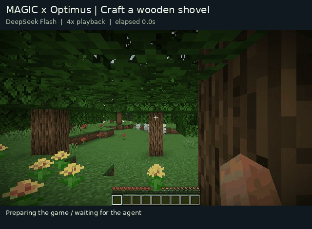
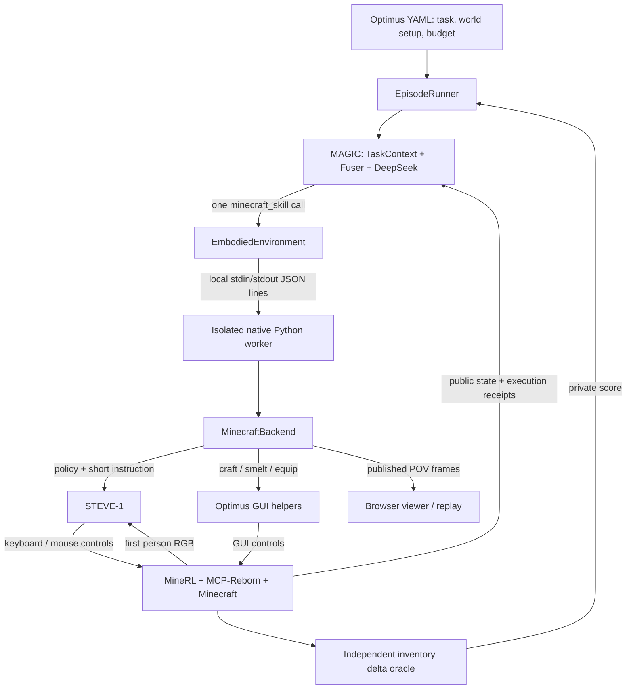

# Optimus-1 Benchmark Integration

Geek Mind's shared decision loop also operates in **[Optimus-1 / Minecraft](https://github.com/iLearn-Lab/NeurIPS24-Optimus-1)**. The integration in [MAGIC](https://github.com/awesomeNabi/MAGIC) uses the upstream task definitions, MineRL environment, STEVE-1 controller, and GUI helpers. MAGIC supplies the high-level agent: read public game state, select a skill, inspect the result, and continue toward the original goal.

> Implementation checked at MAGIC commit `0f8147ff933c95c24590c58c5bc35f4c222f743e` and Optimus-1 commit `409356cc324a3bf64f31653c6bc0f926b672f19c`. Last updated 2026-10-14. This repository publishes the integration guide and demonstration; the executable benchmark adapter lives in MAGIC.



*DeepSeek Flash selects skills; STEVE-1 and Optimus GUI helpers execute them. This successful wooden-shovel episode takes 1,430 native control steps, 7 skill calls, and 298.8 seconds. The GIF is a 4× replay of published game frames.*

## Current result

**Overall success rate: 24.36%.** This is the project-reported result as of 2026-10-14, with the aggregation confirmed by the project owner. It follows the [official overall definition](https://github.com/iLearn-Lab/NeurIPS24-Optimus-1#smile_cat-evaluation-results): an unweighted mean of the success rates for **Iron, Gold, Diamond, Redstone, and Armor**.

```text
Overall SR = (SR_Iron + SR_Gold + SR_Diamond + SR_Redstone + SR_Armor) / 5
           = 24.36%
```

Wooden and Stone are outside this overall metric. In particular, the wooden-shovel GIF illustrates execution and is not the evidence used to calculate 24.36%.

The [published metadata](docs/assets/optimus-benchmark.json) records the reported aggregate, its definition, the checked source catalog, and the replay's actual actions. Per-group rates, aggregate episode counts, and uncertainty estimates were not supplied for this publication; no group scores are inferred from the aggregate. The replay's source batch was paused after one completed episode, so its local report cannot reproduce the overall result.

Matching the overall aggregation does not establish an exact paper reproduction: this adapter exports **73 source tasks**, and alignment to the paper's precise 67-task selection, budgets, and repetition protocol remains pending.

## Why Optimus-1

Minecraft tasks require an agent to manage dependencies over time: gather logs, turn them into planks, make a crafting table and sticks, and then craft a tool. More advanced tasks require mining, smelting, equipment, and longer material chains. This tests goal tracking, prerequisite planning, resource use, and recovery from failed actions.

The upstream project describes a knowledge-guided planner, an experience-driven reflector, and an action controller. This integration reuses its task and execution infrastructure while MAGIC provides the decision loop. The upstream GPT planning server and hybrid multimodal memory are not required by this execution path. See the [official framework description](https://github.com/iLearn-Lab/NeurIPS24-Optimus-1#balloon-optimus-1-framework).

The exporter reads every group's `all_task`, rather than the upstream demonstration-only `evaluate` selection:

| Source group | Tasks | Native control-step budget per episode | Included in overall |
| --- | ---: | ---: | --- |
| Wooden | 12 | 2,400 | No |
| Stone | 10 | 6,000 | No |
| Iron | 17 | 24,000 | Yes |
| Gold (`golden` in source) | 7 | 36,000 | Yes |
| Diamond | 7 | 36,000 | Yes |
| Redstone | 7 | 36,000 | Yes |
| Armor | 13 | 36,000 | Yes |
| **Total** | **73** | Group-specific | **Five groups** |

Step limits come from each group's `env.max_minutes × 1200`. The export retains the original instruction, initial inventory, biome settings, initialization commands, and source hashes. Script names containing `optimus67` are historical names, not a declaration that the exported catalog contains 67 tasks.

## Architecture



MAGIC and the native worker use separate Python environments to isolate MineRL's dependencies. Communication is a local subprocess request/response protocol with one JSON message per line; the integration does not require an Optimus HTTP planning service. DeepSeek is called through the configured model API.

The adapter lives under `src/benchmarking/`. It reuses the Fuser, task context, and model clients without launching the production robot runtime or hardware services.

## Key decisions

The settings below are verified for the **published replay batch**. They document how the demonstration ran; they do not infer missing configuration for the separately reported overall aggregate.

| Dimension | Current integration / replay setting |
| --- | --- |
| High-level model | `deepseek-flash`, configured by `config/benchmarks/deepseek.json5` |
| High-level observation | Public game state rendered as text |
| Low-level observation | First-person RGB to STEVE-1 |
| Process model | A fresh native worker and Minecraft world per independent episode |
| Native tools per decision | At most 1 |
| Skill window | At most 1,200 native control steps |
| Action / decision limits | 100 / 100 per episode |
| Wall-clock budget | 21,600 seconds per episode |
| Recovery | `repeat`, up to 3 replans within the same world and remaining budget |
| Optional modules | Planner off; verifier `none`; memory disabled |
| Replay repeat label | `--seeds 0`; deterministic world control is not guaranteed |
| Success protocol | `optimus-source-inventory-v1` |

## Action space

The model calls one structured tool, `minecraft_skill`, with `skill`, `instruction`, `item`, `quantity`, and `steps`:

| Skill | Execution | Meaning |
| --- | --- | --- |
| `policy` | STEVE-1 | Follow a short physical instruction, such as chopping a tree or mining |
| `craft` | Optimus GUI helper | Craft the requested item using available ingredients |
| `smelt` | Optimus GUI helper | Smelt through the native interface |
| `equip` | Optimus GUI helper | Equip the requested item |

```json
{
  "skill": "craft",
  "instruction": "Craft a wooden shovel",
  "item": "wooden_shovel",
  "quantity": 1,
  "steps": 600
}
```

This is the final call from the published replay. The helper consumed 297 of its allowed 600 steps. `steps` counts low-level game controls, including helper initialization and GUI clicks; it is not an item count. `quantity` is the requested output count for GUI helpers. For `policy`, `item` and `quantity` describe the intent and do not guarantee acquisition or cause automatic stopping at that item count.

Helpers do not recursively produce missing ingredients. MAGIC must inspect inventory and prepare the material chain, including a crafting table before a 3×3 recipe. Agent actions do not invoke `/give`; the policy's `chat` field is removed and `ESC` is disabled. Official setup commands are used only when initializing the task.

## Observation and success

MAGIC sees only these native public fields:

```text
inventory · equipped_items · life_stats · location_stats · isGuiOpen
```

`BenchmarkInput` formats the state as text. `TaskContext` carries the original goal, current instruction, budgets, and action feedback; the Fuser assembles the next model request. DeepSeek does not receive Minecraft screenshots in this configuration. RGB feeds STEVE-1 and the viewer. Private oracle results and initialization commands are excluded from agent observations.

The independent oracle checks the increase in exact target inventory items relative to the episode's initial inventory. The source exporter currently requests an increase of one target item. A wooden shovel matches `wooden_shovel`; `chop a tree` accepts the reviewed set of log types. The backend updates this check on counted control steps and latches success once reached.

This is an acquisition-based adapter oracle, not a reproduction of every upstream task-checker semantic. It does not prove that every possible acquisition route satisfies a stronger requirement such as personally crafting the item.

`completed` in a skill receipt means the call completed, not that the original task succeeded. Likewise, the model's `benchmark_finish(success=true)` cannot override the oracle. Reports distinguish `first_success`, `final_success`, and `claimed_success`, and retain budget and environment-error outcomes.

MAGIC's generic `sr_final` averages episodes, and `sr_final_macro` averages tasks. Because groups have different sizes, neither is automatically the five-group overall. To reproduce that overall, calculate each named group's SR on the declared evaluation set and then take the mean of those five rates.

## Decision loop and recovery

1. Export the source task, then verify its identity and file hashes at reset.
2. Start an isolated worker, initialize the native world, record the initial inventory, and load STEVE-1.
3. Fuse the goal, public observation, remaining budget, and execution feedback into a model request.
4. Validate one `minecraft_skill` call and execute it within its skill window and the total episode budget.
5. Read the new observation and receipt; update the private score from actual inventory changes.
6. End on success, terminal state, or exhausted budget. At an attempt boundary, apply the selected recovery mode.
7. Record the episode and clean up its owned Python/Java process tree before the next task.

`--recovery off` ends at a failed attempt boundary. `--recovery repeat` continues the original goal in the same world when replans remain. `--recovery verify --verifier magic` enables a model verifier at attempt boundaries, and `--planner` adds an initial decomposition step. These are optional switches; the replay used repeat recovery and needed **zero** replans. Recovery never replenishes the total control-step budget.

Runtime guards reject random fallback observations after a game communication failure, bound socket waits, and track process cleanup. The replay configuration enables `continue_on_environment_error`: a failed disposable world can be recorded and the batch continued only after its owned processes are verified as cleaned up. Unreconciled state stops the batch.

## Running the integration

Run from a **MAGIC checkout**, with its Python environment and an independently installed Optimus/MineRL environment. Prerequisites include a compatible NVIDIA/PyTorch stack, Java 8, Xvfb, the compiled MCP-Reborn JAR, and the four upstream VPT / STEVE-1 / MineCLIP checkpoint files. Follow the [MAGIC setup guide](https://github.com/awesomeNabi/MAGIC/blob/0f8147ff933c95c24590c58c5bc35f4c222f743e/benchmarks/OPTIMUS_BEGINNER_GUIDE.zh-CN.md) and [upstream installation instructions](https://github.com/iLearn-Lab/NeurIPS24-Optimus-1/tree/409356cc324a3bf64f31653c6bc0f926b672f19c).

Store model credentials in the ignored `.env` file using `BENCHMARK_API_KEY`, `BENCHMARK_BASE_URL`, and `BENCHMARK_MODEL`. For this replay the model ID is `deepseek-flash`. Do not put credentials in published configs or artifacts.

With the native installation and an experiment config already prepared:

```bash
cd /absolute/path/to/MAGIC
export MAGIC_PYTHON="$PWD/.venv/bin/python"
export OPTIMUS_ROOT="/absolute/path/to/Optimus-1"
export MINECRAFT_PYTHON="/absolute/path/to/native-venv/bin/python"
export NATIVE_CONFIG="/absolute/path/to/minecraft.full.json"
export LLM_CONFIG="$PWD/config/benchmarks/deepseek.json5"
export MINERL_TMP_INSTANCES=1

# Select the source tasks and run preflight, export, and evaluation.
PILOT_TASK_IDS=all PILOT_SEEDS=0 RECOVERY=repeat bash run_optimus67_pilot.sh
```

The launcher reads `.env` and then `OPTIMUS_ENV_FILE` (default: `logs/benchmarks/optimus.local.env`); check these for overrides of exported settings. `setup_optimus67.sh` generates config/checkpoint digests but does not install Minecraft or model weights. Its default limits are a smoke test (6 actions, 6 decisions, 0 replans, 900 seconds). Prepare the full config using the settings above before a full run; existing configs are not overwritten. `RUN_DIR`, if supplied, must be a new output directory.

Outputs include `doctor.json`, the exported source and selected task lists, `results/manifest.json`, `results/episodes.jsonl`, and `results/report.json`. Read the manifest's planned/completed counts and run status before treating a report as a complete evaluation.

For the optional live viewer, set the native config's `visualization_dir` to an absolute directory, then use the same directory here:

```bash
"$MAGIC_PYTHON" scripts/watch_optimus.py \
  --run-dir /absolute/path/to/run \
  --public-dir /absolute/path/to/live \
  --host 127.0.0.1 --port 8765
```

The viewer publishes first-person frames every 20 native steps and at skill boundaries. It reads progress artifacts and does not change the model's observation or issue game controls.

## Replay provenance

The supplied GIF is preserved byte-for-byte as [`optimus-agent-demo.gif`](docs/assets/optimus-agent-demo.gif). It comes from run `optimus-full-20261014-183024`, task `minecraft/wooden/00`, and ends with `environment_completed`, `final_success=true`.

| Call | Skill | Requested operation | Actual control steps |
| ---: | --- | --- | ---: |
| 1 | `policy` | Chop a tree to get a log | 200 |
| 2 | `policy` | Continue chopping to collect logs | 600 |
| 3 | `craft` | 4 oak planks | 79 |
| 4 | `craft` | 1 crafting table | 101 |
| 5 | `craft` | 4 more oak planks | 66 |
| 6 | `craft` | 4 sticks | 87 |
| 7 | `craft` | 1 wooden shovel | 297 |
| **Total** | | | **1,430** |

The 640×470 GIF contains 77 frames and lasts 57.37 seconds, including an outcome card. It covers the available visualization frames at 4× speed, not a continuous 20-fps screen recording; startup before the first image is not shown. The complete episode duration is 298.8 seconds.

SHA256: `213ed4ba7b9b24671dffbe56916ff6ed85de1044ab68667d72f76ff81a70db3d`.

The [website](https://awesomenabi.github.io/Geek-Mind/#optimus) provides play/stop controls, a static poster, and the recorded action table. The [metadata JSON](docs/assets/optimus-benchmark.json) includes the original tool arguments and actual step counts without publishing raw logs or machine paths.

## Implementation map

All paths below refer to the checked MAGIC revision:

| Source | Responsibility |
| --- | --- |
| [`embodied_catalog.py`](https://github.com/awesomeNabi/MAGIC/blob/0f8147ff933c95c24590c58c5bc35f4c222f743e/src/benchmarking/embodied_catalog.py) | YAML task export, exact inventory targets, group budgets, hashes |
| [`magic_agent.py`](https://github.com/awesomeNabi/MAGIC/blob/0f8147ff933c95c24590c58c5bc35f4c222f743e/src/benchmarking/magic_agent.py) | TaskContext/Fuser input, model calls, optional planner and verifier |
| [`embodied.py`](https://github.com/awesomeNabi/MAGIC/blob/0f8147ff933c95c24590c58c5bc35f4c222f743e/src/benchmarking/embodied.py) | Native worker lifecycle, tool schema, observation and score separation |
| [`embodied_worker.py`](https://github.com/awesomeNabi/MAGIC/blob/0f8147ff933c95c24590c58c5bc35f4c222f743e/src/benchmarking/embodied_worker.py) | Native interpreter entry point and request dispatch |
| [`embodied_minecraft.py`](https://github.com/awesomeNabi/MAGIC/blob/0f8147ff933c95c24590c58c5bc35f4c222f743e/src/benchmarking/embodied_minecraft.py) | Minecraft reset/step, GUI helpers, inventory oracle, POV publication |
| [`embodied_policies.py`](https://github.com/awesomeNabi/MAGIC/blob/0f8147ff933c95c24590c58c5bc35f4c222f743e/src/benchmarking/embodied_policies.py) | STEVE-1 prompt/image inference and controller reset |
| [`runner.py`](https://github.com/awesomeNabi/MAGIC/blob/0f8147ff933c95c24590c58c5bc35f4c222f743e/src/benchmarking/runner.py) | Episode loop, budgets, action receipts, recovery |
| [`metrics.py`](https://github.com/awesomeNabi/MAGIC/blob/0f8147ff933c95c24590c58c5bc35f4c222f743e/src/benchmarking/metrics.py) | Episode/task/category aggregation; distinct from five-group overall |

## Known boundaries

- The current source suite contains 73 tasks. The paper's exact 67-task protocol has not been reproduced here.
- `--seeds` labels repeats; the adapter records `seed_controls_environment=false`, so strict paired comparison is refused.
- High-level reasoning is text-only, although the local controller consumes RGB. This is not a high-level vision-language track.
- The score measures target-item inventory increase. Helper completion and model claims alone do not establish task success.
- The published overall is a project-reported five-group aggregate; the single wooden replay cannot validate its constituent group scores.

## References

- [Official Optimus-1 repository](https://github.com/iLearn-Lab/NeurIPS24-Optimus-1)
- [Optimus-1 paper, arXiv:2408.03615](https://arxiv.org/abs/2408.03615)
- [MAGIC Optimus beginner guide](https://github.com/awesomeNabi/MAGIC/blob/0f8147ff933c95c24590c58c5bc35f4c222f743e/benchmarks/OPTIMUS_BEGINNER_GUIDE.zh-CN.md)
- [StarDojo integration](STARDOJO.md)
- [Geek Mind project website](https://awesomenabi.github.io/Geek-Mind/)
