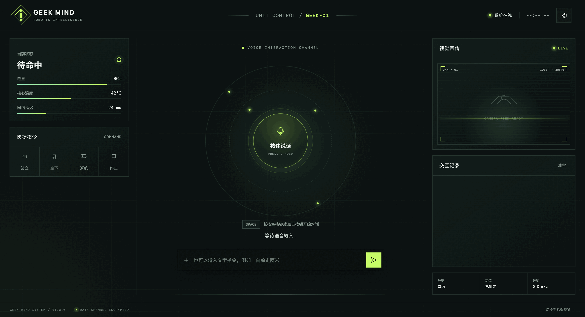
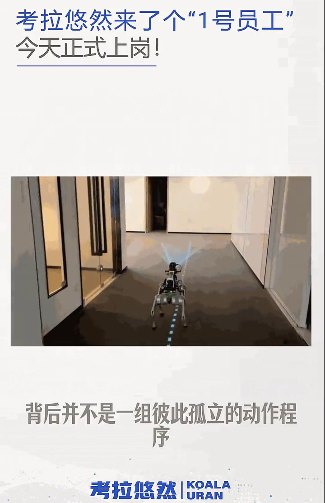
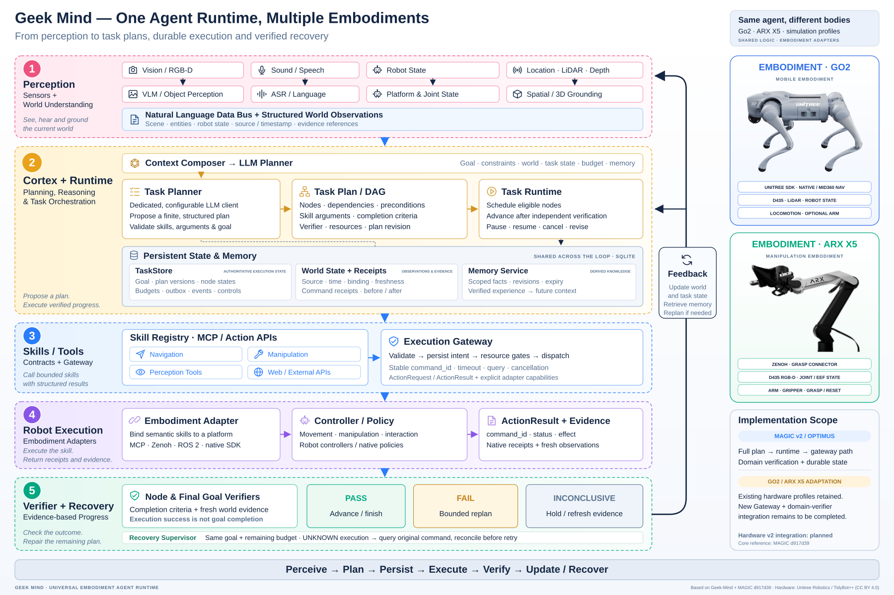
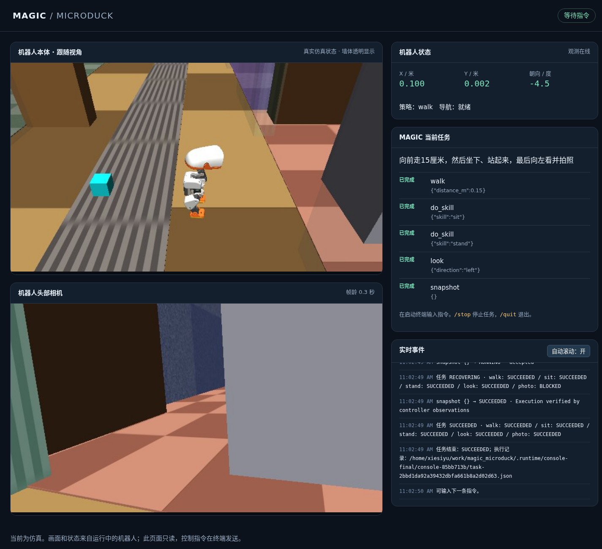
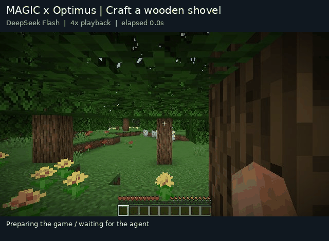
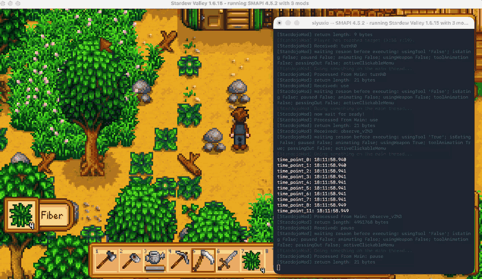

<div align="center">

# Geek Mind

**Universal Embodiment Agent Runtime**

One Agent Runtime · Multiple Embodiments · Perception-to-Action Closed Loop

[Project Website](https://awesomeNabi.github.io/Geek-Mind/) · [Website Source](./website/)

</div>

Geek Mind is an embodied-agent runtime for connecting multimodal interaction, task planning, tool use, and physical execution across heterogeneous robots. A shared Cortex loop turns voice, text, vision, and robot state into semantic actions, while embodiment adapters route those actions to platforms such as Unitree Go2 and ARX X5 and feed verified execution results back into the next planning cycle. The MAGIC task runtime also controls Microduck in MuJoCo / ROS 2, with natural-language commands, live camera views, and terminal feedback.

## Frontend



## Project Demo

<p align="center">
  <a href="docs/assets/geek-mind-demo.mp4">
    
  </a>
  <br>
  <a href="docs/assets/geek-mind-demo.mp4"><strong>▶ Play the project demo (MP4)</strong></a>
</p>

## Architecture



The diagram summarizes four stages in a closed loop: Perception, Cortex LLM, MCP / Tools, and Robot Execution. Sensor inputs become language-aligned context; the Cortex reasons and selects tools; execution feedback updates state and memory for the next step. The Go2 and ARX X5 embodiments retain their own sensors, connectors, and actuators while sharing the same high-level task and feedback path.

## Capabilities

- **Multimodal interaction** — voice, text/UI, VLM/vision, and speech output.
- **Language-aligned context** — input fusion across live observations, robot state, memory, and available tools.
- **Task and Cortex loop** — task decomposition, LLM/MCP planning, tool selection, and state-driven progression.
- **Action orchestration** — validate, route, dispatch, monitor, and collect physical action results.
- **Multi-embodiment integration** — configuration-driven providers and connectors for Go2 mobility/navigation and ARX X5 manipulation, plus an MCP / ROS 2 bridge for Microduck simulation.
- **Runtime safeguards** — configuration validation, hardware preflight, input-freshness gates, bounded tool/action execution, result verification, and cancellation.

## Deployment Profiles

| Profile | Main capabilities |
| --- | --- |
| Unitree Go2 | Voice interaction, robot state, D435 vision, native or Mid360 navigation |
| ARX X5 | RGB-D perception, grasp planning, arm/gripper execution, status feedback |
| Go2 + ARX X5 | Mobile manipulation with coordinated navigation, grasping, and delivery tasks |
| Microduck / simulation | Natural-language motion and navigation, dual camera views, live task status through a separate integration workspace |

Deployment is hardware-specific. See [Ubuntu 22.04 + ROS 2 Humble deployment](HUMBLE_SETUP.md) for the Go2 + Mid360 stack, or [Go2 + ARX startup](STARTUP.md) for the combined robot workflow. Real-robot operation must be supervised with a working emergency stop and a clear operating area.

## Microduck Simulation

MAGIC controls the Microduck robot in a simulated apartment through its existing **TaskPlanner → TaskRuntime → ExecutionGateway → MCP** path. The ROS 2 bridge connects MuJoCo, learned motion policies, and Nav2. A continuous terminal session accepts natural-language goals and displays planning, action status, and receipts; a read-only browser panel shows the robot body and head camera alongside the current task.



In the prepared `magic_microduck` workspace, start with `bash run.sh chat` and open `http://127.0.0.1:8780`. A real-model instruction—“向左转20度，然后坐下，再站起来”—completed all three actions. The fixed five-action demo and 23 automated checks also passed (project-reported, 2026-11-09). These are simulation integration checks; physical Microduck operation is not yet validated.

See the [Microduck integration guide](MICRODUCK.md) for workspace requirements, startup, tools, results, and cancellation boundaries, or [explore the website section](https://awesomenabi.github.io/Geek-Mind/#microduck). The adapter resides in a separate local workspace; cloning this repository alone does not install it.

## Benchmark Evaluation

The shared decision loop also connects to **[Optimus-1 / Minecraft](https://github.com/iLearn-Lab/NeurIPS24-Optimus-1)** through the MAGIC benchmark adapter. MAGIC selects skills from text observations; STEVE-1 and native GUI helpers execute them, and an independent inventory check judges task completion.

**Current overall success rate: 24.36%**, the unweighted mean of Iron, Gold, Diamond, Redstone, and Armor success rates, following the official overall definition (project-reported, 2026-10-14). The integration exports 73 source tasks across seven groups; it has not yet been aligned to the paper’s exact 67-task protocol.



The replay completes `minecraft/wooden/00` in 1,430 control steps and 7 skill calls. Wooden tasks are outside the five-group overall metric. See the [Optimus integration guide](OPTIMUS.md) for the architecture, tools, scoring, run commands, and replay provenance, or [explore it on the project website](https://awesomenabi.github.io/Geek-Mind/#optimus).

Beyond physical robots, the same Cortex loop is evaluated in [StarDojo](https://weihaotan.github.io/StarDojo/docs/), a long-horizon language-agent benchmark built on Stardew Valley. The agent reads a text observation of the game world, plans multi-step tasks, and calls structured atomic skills; only the official task evaluator decides success.



Mandating two-action batching and adding combat affordances lifted farming success from 4.8% to 23.8% on the Lite-100 split. See the [StarDojo integration guide](STARDOJO.md) for the action space, observation contract, agent protocol, and known boundaries.

## Repository Layout

```text
config/          Agent, model, sensor, action, and deployment configurations
scripts/         Environment setup and stack lifecycle commands
service/         Voice, navigation, perception, and hardware service bundles
system_hw_test/  Hardware and transport diagnostics
tests/           Configuration, integration, and deployment checks
tools/           Validation and environment verification utilities
docs/assets/     Architecture and project media
```

## Media Coverage

- [微信公众号｜Geek Mind 项目报道](https://mp.weixin.qq.com/s/_3Vhwg3F90XdgVEWZ5oUNA)
- [中国日报网｜考拉悠然携 Geek Mind 亮相 APEC 数字周：以世界模型推动具身智能走向真实世界](https://cn.chinadaily.com.cn/a/202608/04/WS6a718c1aa310d709c2fc1665.html)
