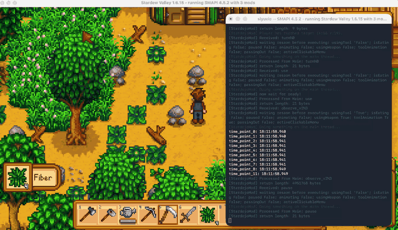
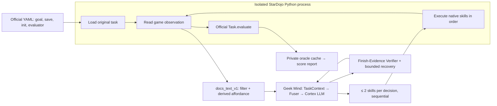

# StarDojo Benchmark Integration

Geek Mind's decision loop is evaluated not only on physical robots but also in **[StarDojo](https://weihaotan.github.io/StarDojo/docs/)**, a long-horizon language-agent benchmark built on Stardew Valley (SMAPI + StarDojoMod). This page describes how the runtime is wired into StarDojo, what the agent can and cannot see, and what the current results look like.

> Verified against official StarDojo commit `f36b55a6be5678692daab14773554b46a31b90a3`. Last updated 2026-10-14.



*The agent reads a text observation of the game world, emits up to two atomic skills per decision, and the official task evaluator judges completion.*

## Why StarDojo

StarDojo turns Stardew Valley into an interactive agent testbed. The agent receives a goal and the current world state, calls structured skills, and keeps deciding from the new state. A task such as "craft a chest" may require checking the inventory, selecting an axe, gathering wood, crafting, and confirming the chest entered the inventory.

This exercises exactly the capabilities the shared Cortex loop depends on: goal understanding, action parameters, dependency ordering, resource budgeting, progress tracking, and failure recovery. A game result does not prove real-robot grasping or motion control; it checks whether the decision layer can sustain multi-step tasks.

The official full set has 1000 tasks across five categories, each with easy / medium / hard difficulty. The current integration targets the **Lite-100** split:

| Category | Typical activity | Lite tasks |
| --- | --- | --- |
| Farming | planting, watering, harvesting, animal care | 21 |
| Crafting | making items, cooking, preparing materials | 14 |
| Exploration | routing, resource collection, quest progress | 28 |
| Combat | fighting named monsters | 12 |
| Social | dialogue, trading, gifting, relationships | 25 |

Lite-100 breaks down to 56 easy, 27 medium, 17 hard.

## Architecture



A text-only adapter wraps the native skills as structured JSON tools. The model and the verifier read the goal, the text observation, and execution facts; the oracle success flag, init commands, and screenshots never enter their observation. The official evaluator alone decides success.

## Key decisions

| Dimension | Current setting | Notes |
| --- | --- | --- |
| Observation | Text-only (`docs_text_v1`) | Screenshots stripped before the prompt |
| Process model | Long-lived HTTP bridge / isolated native worker | Bridge reuses one native runtime across episodes |
| Action space | 9 native atomic skills | `navigate` deliberately disabled |
| `move` semantics | **Relative** tile offset (`move_relative`) | right `(1,0)`, up `(0,-1)`; absolute coordinates rejected |
| Actions per decision | ≤ 2, sequential | No model inference between the two calls |
| Decision budget | easy / medium / hard = 30 / 50 / 150 | Matches official docs; tagged `stardojo-docs-30-50-150` |
| `max_actions` / `max_env_steps` | `2 × max_decisions` | Scales with two-action batching |
| Time budget | 3600 s per episode | Covers the longest hard chains |
| Recovery | Hybrid: routine retry + verifier replan | Routine failures consume total budget, not the replan budget |
| Success | Official `Task.evaluate` | Adapter caches `completed` only, never fed back to the agent |
| RNG control | None | `--seeds` is a repeat label; strict paired comparison is refused |

## Action space

Nine default skills are exposed:

| Tool | Arguments | Notes |
| --- | --- | --- |
| `move` | `x, y` | **Relative** tile offset; target must be a standable tile present in the observation |
| `craft` | `item` | Craft by in-game item name |
| `use` | `direction` | Use the selected tool/item toward `up/right/down/left` |
| `interact` | `direction` | Interact, gather, open doors, talk, harvest |
| `choose_item` | `slot_index` | Zero-based inventory slot |
| `choose_option` | `option_index, quantity, direction` | One-based menu option; `0` closes; `in` buy/take, `out` sell/put |
| `attach_item` | `slot_index` | Attach a tool attachment |
| `unattach_item` | — | Detach the tool attachment |
| `menu` | `option, menu_name` | Open or close a menu |

`navigate` is commented out in the official default config and is not exposed here, to keep the evaluation text-only and local.

## Observation

The adapter filters the raw observation down to public fields (`location`, `position`, `inventory`, `surroundings`, `npcs`, `current_menu`, time/season, farm state, etc.) and strips `image`, evaluator internals, `scenario`, and init commands.

Three derived affordances save the agent from re-deriving spatial facts from raw tiles:

- **`nearby_weeds` / `nearby_walkable_tiles`** (farming): adjacent interactable targets and standable tiles computed from `surroundingsdata`.
- **`nearby_monsters`** (combat): characters in the current location filtered to monsters, each with a `relative_position` in the same convention as `move`, closest first.
- Inventory indices normalized to zero-based; game time formatted; relative coordinates aligned with `move`.

The evaluator receives the **unmodified official raw observation**; `docs_text_v1` only shapes what the model sees.

## Action semantics: "skill returned" ≠ "world changed"

`execute()` compares public state before and after each action and classifies the result:

| `status` / `error_code` | Meaning | Runner reaction |
| --- | --- | --- |
| `completed` + `effect=known` | Public state changed (inventory / position / menu / tile) | Continue |
| `completed` + `effect=no_state_delta` | Skill ran without exception but nothing changed | Treated as failure, routine retry |
| `failed` + `native_move_rejected` | C# pathfinding returned `False` | Verifier / replan path |
| `failed` + `unknown_effect` | Native RPC timeout or cancel | Save episode, stop the batch as `aborted_unknown_effect` |

This closes the early "a returned skill means success" loophole and stops the agent from claiming completion on a bare receipt.

## Agent protocol

A custom agent only implements `reset()` and `decide(context, observation, tools)`. Per episode the agent sees the goal, success criteria, active instruction, subgoals, remaining budget, and the last 8 action results. It never sees `scenario`, the official task object, the evaluator's `completed` / quantity, init commands, or the oracle score.

Each decision carries at most two tool calls. `benchmark_finish` is an extra closing tool the runtime adds on top of the native set; it must be last in the call sequence, and success should only be claimed with observed evidence.

## Decision loop

```
[episode start]
  VoicePlanner (optional)  →  TaskContext.subgoals
      ↓
  Fuser.fuse(system_prompt, BenchmarkObservation, TaskContext, ActionResults)
      ↓
  Cortex LLM (parallel_tool_calls=true)
      ↓
  decode tool calls  →  Decision(actions ≤ 2)
      ↓
  Runner executes in order → execute()
      ↓
  new observation + cached OracleScore
      ↓
  [if finish claimed] Finish-Evidence Verifier re-check
```

The system prompt's core constraints:

- `move(x, y)` is a **relative** offset; only target tiles that appear in `surroundings`.
- Weeding: select the Scythe, then `use(direction)` (not `interact`) from a tile adjacent to the weed.
- Combat: `choose_item` the sword, read `nearby_monsters`, approach in **small 3–5 tile steps** (mine floors are full of rocks and pits), re-read after each move because monsters move, then `use(direction)` toward an adjacent monster.
- **Batching is critical**: emit two actions whenever the second follows directly from the first (e.g. `move` onto a tile adjacent to a target, then `use`/`interact` toward it). A single call wastes half the action budget.
- `no_state_delta` means the world did not change — replan instead of repeating the same call.
- Claim `benchmark_finish(success=true)` only with observed evidence.

## Recent fixes

| Change | Type | Impact |
| --- | --- | --- |
| Routine action failures retry within total budget | fix | No longer consume the `max_replans` budget, which is reserved for verifier replans |
| `nearby_monsters` derived field | feat | Combat success rose noticeably |
| Mandated two-action batching in the prompt | feat | Farming SR 4.8% → 23.8% |
| Clear stuck menus on bridge reset | fix | Protects the long-lived bridge across episodes |
| Finish-Evidence Verifier + hybrid recovery | feat | Layered routine retry and replan |
| State-delta check in the action layer | fix | Blocks illegal moves and false completion |
| Empty tool-call retry; tighter weed observation | fix | Stability |
| Long-lived HTTP bridge mode | feat | `serve-stardojo` + `--stardojo-bridge` |

## Known boundaries

- No RNG control: `--seeds` is a repeat label, not a deterministic seed; strict paired comparison is refused.
- Text-only: results cannot be mixed with image+text tracks.
- `env_steps` counts native skill calls, not game render frames.
- No `navigate` in the first version; cross-location tasks rely on exits plus repeated relative `move`.
- The verifier can suggest a replan but cannot overwrite the oracle.

## References

- [Official StarDojo documentation](https://weihaotan.github.io/StarDojo/docs/)
- [Official StarDojo repository](https://github.com/WeihaoTan/StarDojo)
- [Geek Mind project website](https://awesomeNabi.github.io/Geek-Mind/)
