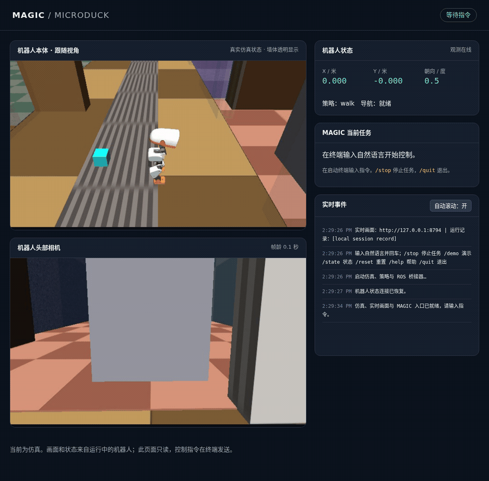

# MAGIC 控制 Microduck

Microduck 仿真接入模块：将自然语言交给 **MAGIC 原有的 TaskPlanner**，再由 **TaskRuntime / ExecutionGateway** 经 MCP 调用 ROS 2 桥接器，控制 Microduck 的 MuJoCo 仿真。

源码位于本仓库的 `integrations/microduck/`，包括 ROS 桥、MCP 服务、MAGIC 任务适配、终端控制台、实时观察页面、启动脚本和测试。通过导入和进程调用复用外部 `MAGIC`、`microduck_ros2`；两个环境不合并。当前实现与验收对象为**仿真机器鸭**。

## 目录与运行前提

默认布局如下；已有环境可直接复用：

```text
work/
├── Geek-Mind/
│   └── integrations/microduck/   # 本模块；从这里运行 run.sh
├── MAGIC/                       # 任务内核源码及 .venv，Python 3.11
└── microduck_ros2/               # ROS 2 / MuJoCo / Nav2，Pixi ci 环境
```

其他布局先在 shell 中导出 `MAGIC_ROOT` 和 `MICRODUCK_ROOT`，见文末。模块可以从任意当前目录通过绝对路径调用 `run.sh`。服务器原来的独立 `magic_microduck/` 工作区保留；仓库里的代码可单独启动验证。

已有两个运行环境时，从 Geek-Mind 根目录执行 `cd integrations/microduck`，然后 `bash run.sh chat` 即可。仅克隆本仓库还需要准备下面的外部依赖。

新机器准备步骤：

1. 准备 [MAGIC](https://github.com/awesomeNabi/MAGIC) 的任务内核源码和 Python 环境，按其环境说明安装依赖。验收版本为 `feat/om1-memory-optimus-validation` 分支的 `d917d39779d09b1c40b8b62eb14c074975c36d30`。需要 `src/tasks`、`src/execution`、`src/state`、`src/mcp_servers`，以及 `.venv/bin/python`；旧版不含这些模块的源码不适用。模型使用该环境中的 OpenAI SDK、JSON5、python-dotenv 等；控制台还使用 Rich。
2. 准备 [microduck_ros2](https://github.com/Arjunros/microduck_ros2) 源码和 Pixi。验收源码版本为 `c967f5cc6616de1efa507108306164747f05597b`。本模块自带 `scripts/microduck-server.sh`，不依赖在上游手工添加 `scripts/server.sh`。它优先使用 `MICRODUCK_ROOT/.local/bin/pixi`，其次使用 PATH 中的 Pixi。
3. 从本模块目录准备仿真环境与资源：

   ```bash
   bash run.sh sim-env install
   bash run.sh sim-env fetch
   bash run.sh sim-env build
   bash run.sh setup
   bash run.sh test
   ```

`sim-env` 将命令交给上游 Pixi 的 `ci` 环境，包含无桌面渲染所需的 Mesa/EGL。模型、上游策略和缓存放在 `microduck_ros2/.local/`；本模块固定的行走权重放在自身 `.assets/`。首次公寓启动会生成 `.local/maps/apartment.yaml` 及地点配置。`pyproject.toml` 不负责自动安装两个外部项目；应通过 `run.sh` 使用已准备好的环境。

本仓库只分发接入源码、配置模板和公开演示；模型权重、运行日志、数据库、虚拟环境和真实 `.env` 不随源码上传。上游模型与策略按各自许可下载使用。

## 实时交互：画面、自然语言与 Agent 状态

现在可以一条命令开启整个交互会话：

```bash
cd Geek-Mind/integrations/microduck
bash run.sh chat
```

命令会启动公寓仿真、导航、ROS 桥、实时渲染和 MAGIC 终端控制台。等待“已就绪”后，在底部输入中文指令并回车，例如：

```text
向左转20度，然后坐下，再站起来
去厨房
拍一张照片
```

任务结束后可继续输入下一条，不必重新启动。终端持续显示机器人位置、策略状态、当前目标、动作计划、每一步的执行状态和回执。规划和执行期间仍可输入 `/stop`，取消规划或停止后续动作，并等待正在执行的动作确认结束。`↑` / `↓` 可回看输入历史，左右键和退格可编辑中文指令。

浏览器打开 **http://127.0.0.1:8780** 查看：

- 机器人本体的第三人称跟随画面，透明显示遮挡镜头的墙体。
- 机器人头部相机的第一人称画面。
- 实时位置、任务计划、Agent 事件和动作结果。

第三人称观察器读取实际仿真场景、物体配置和关节状态；墙体透明仅影响观察画面，物理碰撞与头部相机保持原样。默认以 6 FPS 渲染，观测过期会显示离线状态。连续观看通过内存缓存与 MJPEG 传输，不会不断保存图片。网页为只读观察面板，控制命令在终端输入。

6 FPS 为目标帧率，实际速度受软件渲染负载影响。本服务器最终验收中，两路画面在约 5 秒内各采到 15 个不同帧，最大帧龄约 0.57 秒。为降低开销，实时观察器关闭了阴影和多重采样。



上图为固定 `/demo` 的 13.6 秒录制；运行中的观察页面提供实时画面。

**通过 SSH 使用本服务器时**，在自己电脑的另一个终端建立端口转发，并保持连接：

```bash
ssh -N -L 8780:127.0.0.1:8780 你的用户名@你的服务器地址
```

然后在自己电脑浏览器访问 `http://127.0.0.1:8780`。也可以使用 VS Code 的 Ports 面板转发服务器端口 `8780`。无桌面的服务器不需要安装桌面环境；在有桌面的会话中会尝试自动打开浏览器。

| 终端命令 | 效果 |
| --- | --- |
| 自然语言 | MAGIC 根据当前观测规划并执行，结束后可继续对话 |
| `/demo` | 执行固定五步演示，无需模型 API 调用 |
| `/stop`，或单独输入“停止” | 取消当前任务，阻止后续动作；训练策略仍需自然结束 |
| `/state` | 显示当前完整状态 |
| `/reset` | 无任务执行时重置仿真，并关闭不确定的旧动作记录 |
| `/help` | 查看命令帮助 |
| `/quit`、Ctrl+C、Ctrl+D | 结束会话并关闭本次启动的子进程 |

常用选项：

```bash
bash run.sh chat --flat                # 平地场景
bash run.sh chat --plain               # 逐行输入和日志，适合简单终端或重定向
bash run.sh chat --fps 4 --port 8781    # 调整视频帧率和网页端口
bash run.sh chat --no-browser          # 不自动打开浏览器
```

`--llm-config`、`--vision` 的用法与 `ask` 相同。默认复用 MAGIC 已有模型配置。`TERM=dumb` 或非 TTY 会话自动使用逐行模式；常规 SSH 终端使用全屏界面。当前任务执行期间拒绝追加运动任务，等待结束或先停止，避免两条任务同时控制机器人。

如果同一地址已有桥接器，控制台会接入现有环境，退出时保留原有仿真；已有环境需具备本版本桥接器的 `/frame.jpg` 接口。启动器自身创建的仿真则随控制台退出而关闭。使用已运行的平地环境时请加 `--flat`，使就绪检查不要求 Nav2。

每次会话记录保存在 `.runtime/console-*/`：`events.jsonl` 为事件日志，`task-*.plan.json` 为计划，`task-*.json` 为执行结果，`stack.log` / `observer.log` / `agent.log` 为详细日志。

## 分步启动与单次执行

需要准备好以下两个运行环境：

- `$MAGIC_ROOT/.venv/bin/python`：Python 3.11，运行模型、MAGIC 任务内核和 MCP。
- `bash run.sh sim-env`：使用 `$MICRODUCK_ROOT` 中的 Pixi/ROS 2 Python 3.12 环境，包含 MuJoCo、策略权重和 Nav2。

本项目另外固定使用官方 **v8 行走权重**，放在 `.assets/velstand-v8.onnx`，不覆盖原项目资产。当前服务器已准备；新拷贝首次启动时自动下载约 0.8 MB，也可提前运行 `bash run.sh setup`。下载校验 SHA256，版本固定为 `665ae4eb20bfe13bca1ef4ea6d4bb6b4a096e448`。

这是运行所需的兼容设置：现有上游资产的 `main` 分支仍提供旧版行走策略，实测无法按导航配置有效原地转向；官方 [v8 manifest](https://huggingface.co/pollen-robotics/microduck-policies/blob/665ae4eb20bfe13bca1ef4ea6d4bb6b4a096e448/manifest.json) 对应带转向跟踪能力的版本。坐下、站立等其他策略仍复用已有资产，权重沿用上游许可。

终端一启动公寓场景、导航、相机和桥接器，等待 `READY`：

```bash
cd Geek-Mind/integrations/microduck
bash run.sh up
```

终端二运行演示；此命令使用 MAGIC 任务内核，无需模型调用：

```bash
cd Geek-Mind/integrations/microduck
bash run.sh demo
```

演示依次执行：前进 15 厘米、坐下、站起来、向左看、拍照。输出计划文件、各节点状态和最终执行结果。

终端一未启动或已退出时，`demo`、`ask` 等命令会直接提示桥接器不可达并指明先运行 `bash run.sh up`，而不是抛出 `Error executing tool get_state`。

使用现有模型进行自然语言控制：

```bash
bash run.sh ask "向前走15厘米，然后坐下、站起来，最后向左看并拍照"
bash run.sh ask "去厨房" --plan-only
```

`--plan-only` 只生成并保存计划；确认计划后可用 `bash run.sh plan .runtime/plan-实际编号.json` 执行。`ask` 不带该选项时会自动执行。导航名称以 `bash run.sh state` 返回的 `places` 为准，例如 `kitchen`。

在终端一按 Ctrl+C 会关闭本次启动的桥接器和仿真进程。默认不常驻后台。只需要平地动作时可用 `bash run.sh up --flat`；`--no-camera` 关闭相机，此时不可拍照。

## 模型配置

`ask` 按顺序读取当前 shell、本项目 `.env` 和 `$MAGIC_ROOT/.env`，已有环境变量优先。默认复用 MAGIC 的 `BENCHMARK_BASE_URL`、`BENCHMARK_MODEL`、`BENCHMARK_API_KEY`，无需复制密钥。

可选覆盖：复制 `.env.example` 为 `.env`，填写 `MAGIC_LLM_BASE_URL`、`MAGIC_LLM_MODEL`、`MAGIC_LLM_API_KEY`。模型必须支持 OpenAI 兼容的工具调用接口。

也可传入已有 MAGIC JSON5 配置中的 `cortex_llm`：

```bash
bash run.sh ask "坐下，然后站起来" --llm-config /实际路径/model.json5
```

`--vision` 会将当前头部相机图像附加给规划模型，需要使用支持图片输入的模型；默认文本模型的视觉能力不作假设。拍照本身只产生图像文件，不代表实现了目标识别或抓取规划。

## 控制与观察

```bash
bash run.sh state
bash run.sh image
bash run.sh action walk '{"distance_m":0.15}' --wait
bash run.sh action turn '{"degrees":30}' --wait
bash run.sh action do_skill '{"skill":"sit"}' --wait
bash run.sh action do_skill '{"skill":"stand"}' --wait
bash run.sh action navigate '{"place":"kitchen"}' --wait
bash run.sh action look '{"direction":"center"}' --wait
bash run.sh stop
```

`action` 默认返回 `command_id` 后立即退出。用 `status <command_id>` 查询，`cancel <command_id>` 请求取消；`--wait` 等待终态。可通过 `--id 自定编号` 重试同一个请求：相同编号与参数返回已有回执，不重复执行。

| 动作 | 参数 | 当前实现 |
| --- | --- | --- |
| `walk` | `distance_m`：−2～2 米 | 根据初始朝向的有符号里程计位移控制，结束后确认停止 |
| `turn` | `degrees`：−180～180 度 | 根据累计里程计转角控制，结束后确认停止 |
| `navigate` | `place` | 将场景地点转换为 Nav2 目标 |
| `navigate_to` | `x`, `y`：各 −10～10 米 | 公寓 `map` 坐标；Nav2 成功且位置误差不超过 0.3 米 |
| `do_skill` | `skill` | `sit`、`stand`、`kick_left`、`kick_right`、`roulade`、`ground_pick` |
| `look` | `direction` | `left`、`right`、`up`、`down`、`center`；确认命令已发送，未测量头部最终姿态 |
| `snapshot` | 无 | 保存新鲜 ROS 相机帧为 JPEG |

训练策略动作通过上游 Trigger 服务启动，根据 `policy_state` 转换和结束状态观察完成；坐下还会等待稳定时间。**上游没有中途取消训练策略的接口**，`stop` 不能保证打断这类动作。行走与导航的取消会等待控制器回执及停止观测；取消请求本身不视为已停止。

## 接入结构

```text
自然语言 / JSON 计划
        ↓
MAGIC TaskPlanner → TaskRuntime → ExecutionGateway    [MAGIC Python 3.11]
        ↓  MCPClientManager（SDK 1/2 字段兼容适配）
MCP stdio server
        ↓  127.0.0.1:8766 HTTP
ROS bridge + 动作回执数据库                           [ROS Python 3.12]
        ↓  /cmd_vel、Trigger、NavigateToPose、相机/里程计/策略状态
Microduck MuJoCo + 官方运动策略 + Nav2
```

两个 Python 环境通过本机 HTTP 交互，避免在 MAGIC 虚拟环境安装或导入 ROS 绑定。桥接器只监听 `127.0.0.1`。

`nav` 启动时基于上游参数生成 `.runtime/nav2.generated.yaml`，将路径控制器转向加速度调整为 `10 rad/s²`，保持原有 `1 rad/s` 转向速度上限。在本服务器实测，上游 `4 rad/s²` 限制使初始转向命令停留在 `0.4 rad/s`，落入步态死区，机器鸭无法完成转向。这项覆盖仅保存在本项目中。

本项目使用 MAGIC 的规划、持久化任务、执行网关、验证器和 MCP 客户端；不启动原来的完整 Cortex/语音交互服务。长动作由任务内核异步轮询，避免将运动完成时间塞进单次 MCP 调用。

MCP 暴露 `get_state`、`get_capabilities`、`submit_action`、`get_action_status`、`cancel_action`、`stop`、`get_image` 七个工具。`config/mcp.json` 提供其他 MCP 客户端可参考的服务配置模板，使用前将 `/absolute/path/to/Geek-Mind` 替换为实际绝对路径；本项目运行器会自动生成自己的绝对路径配置。直接在原 MAGIC 中使用该片段时，还需要其 MCP 客户端支持当前 SDK 的工具 schema 字段；本项目在 `mcp_compat.py` 内处理兼容，不会修改原 MAGIC。

## 执行记录与恢复

- `.runtime/tasks.sqlite3`：MAGIC 的任务、节点、动作和证据记录。
- `.runtime/actions.sqlite3`：桥接器持久化的指令与回执。
- `.runtime/plan-*.json`：模型输出经参数检查、串行化后的计划。
- `.runtime/images/`：相机照片；`image` 命令输出具体路径。
- `.runtime/stack-*/`：每次启动的 `sim.log` 和 `bridge.log`。
- `.assets/source.json`：固定行走权重的来源、版本与 SHA256。

每次最多 12 个动作，单只机器鸭串行执行。运行时使用里程计、策略状态、导航结果和图像文件验证各动作；下一步等待前一步完成。

MAGIC 内核在等待异步动作期间会显示节点 `BLOCKED`、任务 `RECOVERING`，这是其等待回执的内部状态，正常完成后转为 `SUCCEEDED`。

桥接器重启后，未结束的动作标记为 `UNKNOWN`，阻止新动作，不自动重放。确认需要重新开始仿真时使用：

```bash
bash run.sh stop
bash run.sh reset
```

若仍有正在执行或取消未确认的动作，先用 `status` 等待其结束。`reset` 会调用仿真重置服务、结束不确定的旧记录。持久化记录和编号去重不等同于实体设备上的 exactly-once 保证；当前也未提供崩溃后的任务自动续跑。

## 测试

```bash
bash run.sh test                  # 参数约束、去重、取消、重启屏障、MAGIC 执行与 MCP 兼容
bash run.sh smoke                 # 真实平地仿真 + MCP + MAGIC，使用本机固定模型响应
bash run.sh smoke --nav           # 另测真实 Nav2 到达与取消
bash run.sh smoke --nav --live-llm # 使用已有模型配置，发生实际模型 API 调用
```

冒烟测试自动启动与关闭自己的进程，使用 ROS 域 `85`、端口 `8767`，结果和日志保存在独立的 `.runtime/smoke-*/`。普通启动使用域 `84`、端口 `8766`。请勿同时运行两个冒烟测试，也不要在同一个 ROS 域中启动另一个机器鸭控制器。

当前服务器的实际验收记录见 [VALIDATION.md](VALIDATION.md)。

## 更换路径或端口

以下变量需在 shell 中设置；它们不从模型 `.env` 加载：

```bash
export MAGIC_ROOT=/absolute/path/to/MAGIC
export MICRODUCK_ROOT=/absolute/path/to/microduck_ros2
export ROS_DOMAIN_ID=84
export MICRODUCK_BRIDGE_URL=http://127.0.0.1:8766
export MAGIC_DUCK_STATE=/absolute/path/to/session-state
```

在其他机器部署时，需先建立两个上游项目的运行环境，并准备 Microduck 策略资产与 ROS workspace。无桌面辅助脚本已包含在本模块中。本项目的 `pyproject.toml` 不会自动安装这两个大型环境。
